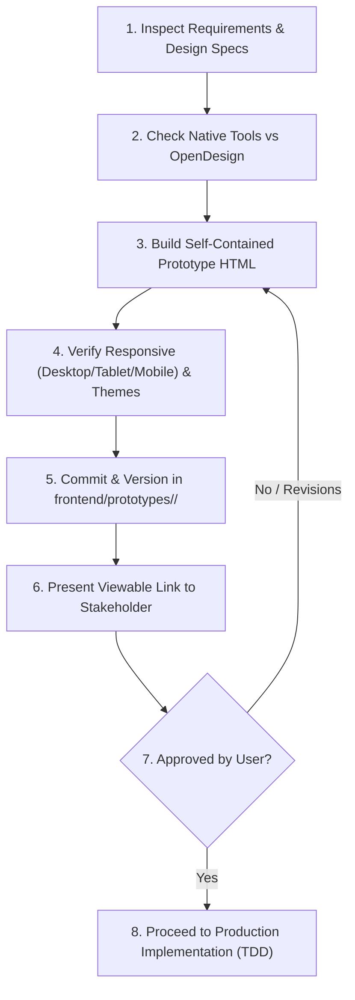

# OpenDesign: Mandatory Visual Prototyping & Screen Approval Protocol

> Integrated from [OpenDesign (`nexu-io/open-design`)](https://github.com/nexu-io/open-design) (Apache 2.0).

This skill governs the visual design, interactive prototyping, stakeholder review, and approval process for all frontend user interfaces in this repository.

---

## 1. The Inviolable Law of Prior Visual Approval

> **No production code shall be written for any frontend screen, page, modal, or complex UI component without prior visual sign-off from the user/stakeholder based on a viewable artifact.**

Every UI implementation follows this strict lifecycle:
1. **Specification & Requirements:** User story and requirements defined.
2. **Interactive Visual Artifact:** Standalone, runnable prototype created and versioned under `frontend/prototypes/<screen-slug>/`.
3. **Prior Visual Approval:** Presented to the user/stakeholder for review and approval.
4. **Production Implementation:** Once (and only once) approved, production components in `frontend/src/` and backend views may be implemented following TDD.

---

## 2. Tooling Hierarchy: Native Design Tools vs. OpenDesign

When executing visual prototyping:

1. **Native Agent Tools (First Priority):**
   - If the code agent operates in an environment with native design or artifact visualization capabilities (e.g., Antigravity visual artifacts, Claude HTML artifacts, v0 rendering, or dedicated canvas previews), the agent **MUST** prioritize and use those native tools to render the interactive artifact directly for the user.
2. **OpenDesign Fallback & Standalone Workflow:**
   - If native visual tools are unavailable, or for offline/browser-based review, the agent **MUST** invoke this OpenDesign workflow to generate self-contained, high-fidelity HTML/CSS/JS prototypes viewable in any standard browser or through the local OpenDesign daemon (`od preview`).

---

## 3. Mandatory Versioning of Prototypes

All prototypes and visual artifacts must be versioned in Git to maintain an immutable design audit trail:

```text
frontend/prototypes/
└── <screen-slug>/
    ├── index.html        # Runnable standalone prototype (HTML + Tailwind + icons + interactions)
    ├── README.md         # Screen metadata, user stories, responsive breakdown, and approval status
    └── assets/           # Optional screenshots, wireframe diagrams, or media assets
```

### 3.1. Standard Prototype `README.md` Template

Each screen prototype folder must include a `README.md` following this structure:

```markdown
# Screen Prototype: <Human-Readable Screen Name>

- **Screen Slug:** `<screen-slug>`
- **Target Route:** `/app/<route-path>`
- **Status:** `[PENDING_APPROVAL | APPROVED | REJECTED]`
- **Approved By:** `<user/stakeholder>`
- **Approval Date:** `YYYY-MM-DD`

## Features & User Stories
- [Story 1 description]
- [Story 2 description]

## Responsive States Verified
- [ ] Desktop (>= 1024px)
- [ ] Tablet (768px - 1023px)
- [ ] Mobile (< 768px)

## Themes Verified
- [ ] Light Theme (per `frontend/DESIGN.md`)
- [ ] Dark Theme (per `frontend/DESIGN.dark.md`)

## Interactive States Covered
- [ ] Default State
- [ ] Hover & Focus Rings (`focus-visible`)
- [ ] Active & Loading (button disables with spinner)
- [ ] Empty State
- [ ] Error State & Validation Banners
```

---

## 4. Design Standards & Token Conformance

Every prototype generated through OpenDesign must adhere to project invariants:

1. **Tokens & Theme Consistency:**
   - **Light Theme:** Strictly observe design tokens in `frontend/DESIGN.md` (colors, typography, spacing, elevations, radiuses).
   - **Dark Theme:** Strictly observe design tokens in `frontend/DESIGN.dark.md`. Include a theme-toggle widget in the prototype so reviewers can inspect both modes.
2. **Three-Screen Responsive Layouts:**
   - **Desktop (>= 1024px):** Full multi-column or sidebar layout, dense information display.
   - **Tablet (768px - 1023px):** Collapsible navigation, fluid grids, touch targets >= 44x44px.
   - **Mobile (< 768px):** Single-column stacked layout, bottom sheets or mobile drawer, zero horizontal overflow, touch targets >= 44x44px.
3. **Web Accessibility (WCAG 2.1/2.2 Level AA):**
   - High contrast text ratios (minimum 4.5:1 for normal text, 3:1 for large text/borders).
   - Distinct, visible focus indicators (`focus-visible:ring-2 focus-visible:ring-offset-2`).
   - Semantic HTML primitives (`<header>`, `<nav>`, `<main>`, `<article>`, `<button>`, `<fieldset>`).
   - ARIA roles and labels for non-text interactive elements (`aria-label`, `aria-expanded`).
4. **Anti-AI-Slop Rules (from `references/anti-ai-slop.md`):**
   - No generic Tailwind indigo accents (`#6366f1`). Use the project tokens.
   - No two-stop purple-to-blue hero gradients or floating glassmorphism cards without semantic purpose.
   - Authentic density and scannable hierarchy over decorative visual noise.
5. **Localization:**
   - All user-facing strings, buttons, form placeholders, badges, and validation messages in the prototype must be strictly in **Brazilian Portuguese (pt-BR)**.
   - Use realistic contextual business data; never use generic "Lorem Ipsum".

---

## 5. Step-by-Step Prototype Workflow



### Step 1: Inspect Requirements & Design Specs
Review the target feature in `docs/superpowers/specs/`, user input, and design token files (`frontend/DESIGN.md`, `frontend/DESIGN.dark.md`).

### Step 2: Determine Tooling Mode
- If native visual tools exist in the running agent harness, prepare the prompt and display the artifact inside the agent interface.
- Simultaneously, save the standalone version to the repository for audit and version control.

### Step 3: Author the Prototype HTML
Construct a single self-contained HTML file (`frontend/prototypes/<screen-slug>/index.html`) utilizing:
- Tailwind CSS via CDN (`https://cdn.tailwindcss.com`) or standard utility classes matching project tokens.
- Lucide or Feather SVG icons embedded inline or via lightweight script.
- Embedded `<script>` for client-side interactions: tab switching, theme toggling (Light/Dark), modal open/close, form validation, and button loading states.
- Clean CSS variables reflecting `--primary`, `--background`, `--foreground`, `--border`, `--radius`.

### Step 4: Verify Multi-Screen & States
Check that the layout resizes cleanly without overflow across Desktop (1200px+), Tablet (768px-1023px), and Mobile (375px-480px). Ensure all states are interactive:
- Default state
- Hover & active states
- Focus states for keyboard navigation
- Disabled & loading state on submit
- Empty and error states

### Step 5: Version the Prototype
Create `frontend/prototypes/<screen-slug>/README.md` and commit both files to Git:
```bash
git add frontend/prototypes/<screen-slug>/
git commit -m "docs(proto): add <screen-name> visual prototype for review"
```

### Step 6: Present to User for Approval
Provide the user with the prototype path for review:
```text
Por favor, revise o protótipo visual da tela '<screen-name>':
- Caminho: frontend/prototypes/<screen-slug>/index.html
- Status: Aguardando aprovação
```
Highlight key design decisions, responsive breakpoints, and theme support.

### Step 7: Await Explicit Approval
Do **not** write any production code (`frontend/src/` or backend views) until the user explicitly responds with approval (e.g., "Aprovado", "Pode prosseguir", "LGTM"). Once approved, mark `Status: APPROVED` in the prototype's `README.md` and proceed with TDD implementation.

---

## 6. References

Consult the accompanying craft documents in `references/`:
- [`references/anti-ai-slop.md`](references/anti-ai-slop.md)
- [`references/accessibility-baseline.md`](references/accessibility-baseline.md)
- [`references/color.md`](references/color.md)
- [`references/typography.md`](references/typography.md)
- [`references/typography-hierarchy.md`](references/typography-hierarchy.md)
- [`references/state-coverage.md`](references/state-coverage.md)
- [`references/form-validation.md`](references/form-validation.md)
- [`references/animation-discipline.md`](references/animation-discipline.md)
