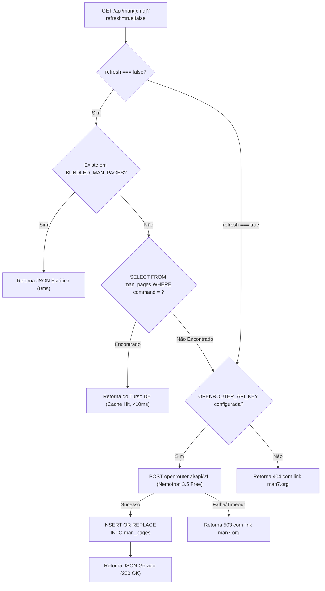

# Just-In-Time Linux Manpage Generator via OpenRouter Nemotron & Turso libSQL

> **Status: Superseded** by [`2026-11-20-command-centric-content-design.md`](2026-11-20-command-centric-content-design.md) — AI generation was removed; the manual reads uploaded content documents.

## 1. Intent & Context

NetDrill offers practical command-line drills and an embedded manual reader (`ManModal` and `/man`) for Linux sysadmin and DevOps engineers. While NetDrill comes pre-packaged with 12 verified, high-frequency production commands (`ps`, `top`, `ss`, `ip`, `find`, `journalctl`, `systemctl`, `chmod`, `iptables`, `tcpdump`, `curl`, `vmstat`), the Linux operating system contains thousands of utilities (`strace`, `rsync`, `jq`, `sed`, `awk`, `btrfs`, `lsof`, `tcpflow`, `nftables`, etc.).

Rather than attempting to bundle hundreds of megabytes of raw groff manpages into a serverless deployment, NetDrill will implement a **Just-In-Time (JIT) Manpage Generator**:
1. When a user queries a command not currently in local memory, an AI agent calls the free `nvidia/nemotron-3.5-super-vl:free` model on OpenRouter.
2. The agent produces a structured JSON manual adhering to NetDrill's schema (synopsis, Brazilian Portuguese technical description, essential production options, and real incident troubleshooting examples).
3. The generated page is **permanently cached** in Turso DB (`man_pages` table). Subsequent queries for that command hit the database directly with sub-10ms response times.
4. The model is **never called again for that command** unless the user explicitly triggers a manual re-generation (`[ 🔄 Regenerar Manual ]`).
5. In all states (cached, generating, or fallback), a direct link to the canonical Linux manual on `man7.org` (`https://www.google.com/search?q=${cmd}+site:man7.org/linux/man-pages`) is provided to open in a new tab (`target="_blank"`).

---

## 2. Goals & Non-Goals

### Goals
- **Zero-Latency Repeat Access:** Persist all generated manuals in Turso (`man_pages` table) so the LLM is queried at most once per command across the entire user base.
- **Zero-Cost LLM Inference:** Leverage OpenRouter's free tier (`nvidia/nemotron-3.5-super-vl:free`) with standard OpenAI-compatible completions.
- **Explicit User Control:** The agent will only re-generate an existing manual if the user explicitly clicks `[ 🔄 Regenerar Manual ]` (`forceRefresh=true`).
- **Canonical Upstream Escape:** Every manual view and search modal provides a one-click link to open `man7.org` (or Google site search) in a new window.
- **Graceful Terminal Degradation:** If OpenRouter times out, rate-limits, or lacks an API key, the UI displays a clean terminal error state with an immediate action button to open `man7.org`.
- **Retro-Terminal Aesthetics:** Monospace JetBrains Mono styling, clear terminal loading states (`[ ⏳ Consultando Nemotron AI... ]`), and zero anti-patterns (`impeccable detect`).

### Non-Goals
- Background scraping or crawling of `man7.org` HTML into the database (man7.org is accessed strictly via direct external links).
- Automated pre-generation of all 15,000 Linux commands (generation occurs on-demand upon first user search).

---

## 3. Constraints

- **Portability:** Zero hardcoded local machine paths (`make portability` gate).
- **Language Policy:** UI copy and manual descriptions in formal Brazilian Portuguese (pt-BR); code, schema, commits, and tests strictly in English.
- **Security:** `OPENROUTER_API_KEY` loaded server-side only via `process.env.OPENROUTER_API_KEY`; never exposed to the client bundle.
- **Resilience:** Safe sanitization of Nemotron responses (stripping markdown backticks ````json` if present before `JSON.parse`).
- **Quality Gate:** `make check` (ESLint, Vitest, Gitleaks, Semgrep, Portability) must pass 100%.

---

## 4. Approaches Considered & Selected

| Approach | Architecture | Trade-offs | Decision |
|---|---|---|---|
| **Approach 1: Static Distro Package** | Bundle all 5,000+ commands as static JSON/Markdown in repo. | Massive repository size (>100MB), slow git clones, exceeds Vercel serverless function size limits. | **Rejected** |
| **Approach 2: Pure man7.org Redirect** | Don't generate anything; simply redirect unknown queries to `man7.org`. | Breaks the unified retro-terminal learning experience; lacks Portuguese descriptions and curated production incident examples. | **Rejected** |
| **Approach 3: JIT Nemotron Generator + Turso libSQL Cache (Selected)** | Query local cache -> Query Turso DB -> If miss, call OpenRouter Nemotron -> Store in DB -> Display in terminal. | Infinite command coverage at $0 cost; sub-10ms for cached items; fallback escape to `man7.org` in new tab. | **Selected** |

---

## 5. System Architecture & Data Model

### Database Migration (`src/lib/migrate.ts` & `src/lib/schema.sql`)

Create table `man_pages` in Turso libSQL and SQLite:

```sql
CREATE TABLE IF NOT EXISTS man_pages (
  command TEXT PRIMARY KEY,
  title TEXT NOT NULL,
  section_name TEXT NOT NULL,
  synopsis TEXT NOT NULL,
  description TEXT NOT NULL,
  options TEXT NOT NULL,     -- JSON array of strings: ["-v : Modo verboso", ...]
  examples TEXT NOT NULL,    -- JSON array of strings: ["rsync -avz /src /dst", ...]
  source TEXT DEFAULT 'ai_nemotron', -- 'bundled' | 'ai_nemotron'
  created_at INTEGER NOT NULL,
  updated_at INTEGER NOT NULL
);
```

### Agent Service (`src/lib/nemotron-generator.ts`)

- Function: `generateManPageWithNemotron(command: string): Promise<ManPage>`
- Target: `https://openrouter.ai/api/v1/chat/completions`
- Model: `nvidia/nemotron-3.5-super-vl:free`
- Parameters: `temperature: 0.1`, `max_tokens: 1500`, `timeout: 30000ms`.
- System Prompt: Enforces strict JSON output with `command`, `title`, `sectionName`, `synopsis`, `description`, `options`, `examples`.
- Response Parser: Strips leading/trailing markdown fences, parses JSON, and validates that all mandatory fields exist and are non-empty strings/arrays.

### Data Lookup Pipeline (`src/lib/man-engine.ts` & `src/app/api/man/[cmd]/route.ts`)



---

## 6. User Interface & Experience

### Architectural Decisions from Builder Review:
1. **Asynchronous Generation Shell (Vercel Timeout Safe):** Both `ManModal` and `/man/[cmd]` render an immediate terminal shell with the retro-terminal loading spinner, delegating Nemotron generation asynchronously to `/api/man/[cmd]`. This guarantees zero Vercel 504 gateway timeouts on the Hobby plan (where SSR execution limit is 10s).
2. **Immutable Bundled Commands:** The 12 curated baseline manuals (`ps`, `top`, etc.) are permanent reference docs. The `[ 🔄 Regenerar ]` button is rendered exclusively for AI-generated commands (`source === 'ai_nemotron'`).
3. **Anti-Hallucination & Anti-Pollution Guard:** The system prompt explicitly instructs Nemotron to return `{"notFound": true}` if the requested command is not a real Linux/POSIX utility. Non-existent commands are never persisted in the database, returning a 404 terminal view with the `man7.org` search link.
4. **Catalogue Discovery & JIT Trigger:** In `/man`, searching for an uncatalogued command displays an action button `[ 🤖 Gerar Manual para "${query}" via Nemotron AI ]`, which navigates to `/man/${query}` to initiate generation.

### 1. Floating Terminal Man Modal (`src/components/ManModal.tsx`)
- **Generating State:** Displays an interactive retro-terminal spinner:
  ```text
  $ man strace
  [ ⏳ Consultando Nemotron AI e indexando manual para 'strace'... ]
  [ 💡 Esse processo ocorre apenas uma vez. As próximas consultas serão instantâneas. ]
  ```
- **Generated View:**
  - Shows badge: `[ 🤖 Gerado por IA (Nemotron) ]`
  - Action button: `[ 🔄 Regenerar ]` (calls API with `?refresh=true`)
  - Canonical Link: `[ 🌐 Ver no man7.org original ↗ ]` (opens `https://www.google.com/search?q=${cmd}+site:man7.org/linux/man-pages` in `target="_blank"`)
- **Error / Offline State:**
  - Displays clear explanation if OpenRouter is unreachable.
  - Highlights direct button: `[ 🌐 Buscar "${query}" no man7.org via Google ↗ ]`.

### 2. Standalone Catalogue (`src/app/man/page.tsx`)
- Lists both bundled and previously AI-generated manual pages stored in the database.
- Search bar with quick button: `[ 🌐 Pesquisar no man7.org ↗ ]`.

### 3. Dedicated Reader (`src/app/man/[cmd]/page.tsx`)
- Server-rendered page integrating DB lookup and Nemotron generation on-demand.
- Action bar with `[ 🔄 Regenerar ]`, `[ 🌐 man7.org ↗ ]` and `[ ⌨️ Treinar no NetDrill ]`.

---

## 7. Verification & Quality Plan

1. **Unit Tests:**
   - `tests/nemotron-generator.test.ts`: Test JSON response parsing, markdown fence removal, error handling, and parameter structure with mocked fetch.
   - `tests/man-db.test.ts`: Verify insertion, retrieval, and upsert of `man_pages` in in-memory SQLite (`runMigrations`).
   - `tests/man-api.test.ts`: Verify `/api/man/[cmd]` respects `?refresh=true`, returns cached items without calling OpenRouter, and handles failures gracefully.
2. **Quality Gate:**
   - `make check`: 100% passing (ESLint, Vitest, Gitleaks, Semgrep, Portability).
   - `npx -y impeccable detect src/`: 0 anti-patterns.
   - `npm run build`: All routes compile cleanly.
